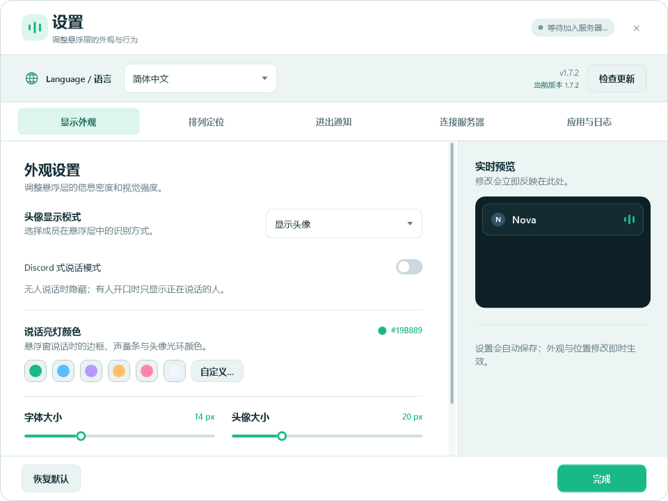
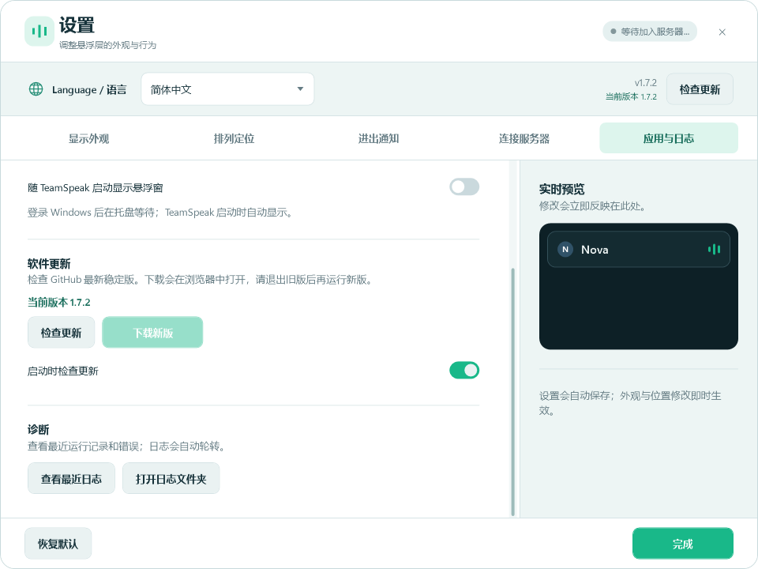
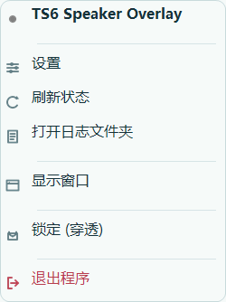

# TS6 Speaker Overlay

TeamSpeak 6 的 Windows 语音悬浮窗，查看当前频道成员与发言状态。

[English](#english) · [下载已发布版本](https://github.com/beka2nt/TS6-SpeakerOverlay/releases/latest) · [反馈问题](https://github.com/beka2nt/TS6-SpeakerOverlay/issues)


当前源码版本为 **1.7.2**。下载链接指向 GitHub Releases 中最新的已发布版本；也可以按下方说明构建当前源码。

## 界面预览



<details>
<summary>查看应用与日志设置、托盘菜单</summary>





</details>

## 功能

- **发言动效与颜色**：说话时边框、声量条与头像光环平滑亮起，支持预设与自定义颜色。
- **四种显示模式**：显示头像、仅头像、仅指示灯、仅名字；分别展示闭麦、关闭声音与离开状态。
- **Discord 式说话模式**：隐藏静默成员，只显示正在说话的人；解锁后保留定位入口。
- **服务器选择**：同时连接多个服务器时，可选择展示来源，头像优先使用所选服务器上的头像。
- **进出通知**：所选服务器成员上线、离线，以及当前频道进入、离开，可分别开关。
- **外观设置**：字体、头像大小、列表间距、背景深度与整体缩放即时生效。
- **鼠标穿透与定位**：通过托盘锁定、解锁、显示、隐藏悬浮窗；解锁后拖动定位，重启后恢复锁定状态。
- **对齐与快速定位**：用户列表支持 Top / Center / Bottom；八个边角预设联动纵向、横向对齐，支持窗口边缘间距和屏幕吸附。
- **Shift 锁轴拖动**：按住 Shift，根据最开始的移动方向锁定横轴或纵轴；中途按下或松开不会跳位。
- **随 TeamSpeak 启动**：可选的后台等待模式，Windows 登录后驻留托盘，检测到 TeamSpeak 启动时显示悬浮窗。
- **随 Windows 启动**：也可选择登录后直接显示；同时开启两个启动选项时，优先等待 TeamSpeak。
- **应用内日志**：查看最近记录、筛选错误、刷新或复制，也可打开日志文件夹。
- **检查更新**：设置页与托盘均可检查 GitHub 最新稳定版；默认启动时后台检查，可关闭。发现新版后在浏览器中下载，不静默替换程序。
- **七种语言**：简体中文、English、한국어、Deutsch、Español、Français、Русский；顶部常驻地球图标与“Language / 语言”入口，选项使用各语言原生名称。

## 开始使用

使用自包含 exe 需要 **Windows x64 和 TeamSpeak 6**，无需单独安装 .NET。从源码构建需要 **.NET 10 SDK**。

1. 启动 TeamSpeak 6，在“设置 → 远程应用程序”中确认接口已启用，并记下端口。
2. 启动悬浮窗，在 TeamSpeak 弹出的授权提示中允许连接。
3. 右键 Windows 托盘图标打开“设置”。选择“连接服务器”，将“远程应用端口”设为与 TeamSpeak 一致。**修改端口后重启悬浮窗。**
4. 加入服务器与频道。若连接多个服务器，在“连接服务器”分类中选择展示来源。

默认端口为 `5899`，设置中提供 `5899 / 6100 / 6200 / 7000` 选项，以你自己的 TeamSpeak 设置为准。

### 设置分类

- **显示外观**：头像模式、只显示说话者、亮灯颜色、字体与头像大小、背景透明度。
- **排列定位**：列表对齐、八方向预设、边缘间距与吸附、列表间距、整体缩放。
- **进出通知**：通知总开关、服务器进出、当前频道进出。
- **连接服务器**：展示服务器、远程应用端口、连接状态与刷新。
- **应用与日志**：Windows / TeamSpeak 启动方式、检查更新、查看日志和打开日志文件夹。

语言入口固定在顶部，分类切换不影响现有设置。右侧只保留预览与自动保存说明；端口变更需重启。

### 移动与锁定

从托盘选择“解锁（拖拽）”，拖动悬浮窗到合适位置，再选择“锁定（穿透）”。悬浮窗获得焦点时也可用 `Ctrl+L` 切换锁定状态。

“显示窗口”和“隐藏窗口”控制悬浮层可见性；“退出程序”会完全退出。设置更改会自动保存。

锁定状态会随设置保存，下次启动时恢复鼠标穿透。

### 对齐、预设与边缘吸附

在“设置 → 排列定位”选择 **顶部 Top / 居中 Center / 底部 Bottom**。居中时，人数变少或静默成员隐藏后，剩余名单仍围绕悬浮窗中点显示；通知与锁定提示不会挤偏名单。

八方向选择器提供四角和四条边的中点。顶部三项自动使用 Top，左右中点使用 Center，底部三项使用 Bottom；右侧预设同时让成员卡片靠右，顶部/底部中点则水平居中。预设作用于**悬浮窗当前所在屏幕的可用区域**，避开任务栏。

“边缘间距”默认为 16，可在 0–80 间调整，使用随 Windows 显示缩放变化的逻辑像素；预设选中时修改间距会立即重新定位。启用吸附后，拖动到边缘附近约 12 个逻辑像素内，会贴到保留该间距的位置。吸附可关闭。

解锁后按住 **Shift** 拖动，首段明显移动决定横向或纵向，之后不随鼠标斜向移动改变；松开 Shift 恢复自由拖动。锁轴时另一方向的精确间距不会被吸附改变。手动拖动后取消预设绑定，但保留列表对齐方式；位置、对齐、间距和吸附选项都会保存。

### 随 TeamSpeak 启动

在“应用与日志”分类中开启“随 TeamSpeak 启动显示悬浮窗”，默认关闭。

开启后，软件为当前 Windows 用户登记登录启动项，登录后先在托盘等待，检测到 `TeamSpeak.exe` 后显示悬浮窗。手动打开会直接显示已有窗口；从托盘完全退出后，本次后台等待也会停止。

若希望 Windows 登录后立即显示，开启“随 Windows 登录直接显示”。当两个启动开关同时开启时，优先使用等待 TeamSpeak 的模式。关闭两个开关会移除本软件的登录启动登记。

### 切换语言与检查更新

设置页顶部固定显示地球图标和 **Language / 语言**，无需滚动即可选择语言。即使看不懂当前界面，也可在选项中找到 `한국어`、`Deutsch`、`Español` 等原生语言名称；托盘中也有相同的语言入口。切换立即生效，并自动保存。

点击设置顶部或托盘菜单中的“检查更新”。软件通过 GitHub 官方 API 读取本仓库最新稳定 Release，按数字比较版本，忽略草稿和预发布版。默认每次启动后台检查一次，不弹出打断使用的对话框；可在“应用与日志 → 软件更新”关闭“启动时检查更新”。

发现新版后，顶部按钮变为“下载新版”，在浏览器中打开官方 EXE 下载；若附件仍在上传，则打开 Release 页面。**下载完成后先退出旧版，再运行新版。** 此功能不会自动覆盖、安装或执行下载文件。网络错误或请求限流会给出提示，可稍后重试。检查更新无需 GitHub 登录，不会发送 TS 授权密钥、配置或日志。

## 日志与本地数据

打开“设置 → 应用与日志 → 查看最近日志”，可以切换“仅错误”、刷新和复制。查看器最多展示最近五个日志文件中的 200 条匹配记录。

数据保存在 `%LOCALAPPDATA%/TS6-SpeakerOverlay/`：

| 内容 | 文件 |
| --- | --- |
| 外观、服务器选择、端口与启动设置 | `config.json` |
| 使用 Windows 当前用户保护机制（DPAPI）保存的授权密钥 | `apikey.txt` |
| 运行记录与异常详情 | `logs/app-YYYY-MM-DD.log`，轮转文件带编号后缀 |

单个日志文件达到 **3 MB** 后轮转，自动保留最近 **30 个文件**。单条超长记录会截断，`apiKey` 字段会脱敏。旧版 `%APPDATA%/TS6-SpeakerOverlay/` 及程序目录中的配置与密钥会在需要时迁移到本地应用数据目录，已有本地数据优先保留。

## 常见问题

**一直等待加入服务器或无法连接**

确认 TeamSpeak 正在运行、已加入服务器，并检查远程应用程序接口与端口。端口变更后需要重启悬浮窗；可使用托盘“刷新状态”重新请求状态，并在日志查看器中检查连接或错误记录。

**说话模式下找不到拖动位置**

先从托盘解锁悬浮窗，使用定位入口调整位置，再锁定以开启鼠标穿透。

**同时连接多个服务器**

在“设置 → 连接服务器”选择“悬浮窗服务器”。成员列表和进出通知跟随所选服务器及当前频道。

## 从源码构建

在 Windows 上安装 .NET 10 SDK，在仓库根目录运行：

```powershell
dotnet restore TS6-SpeakerOverlay/TS6-SpeakerOverlay.csproj
dotnet build TS6-SpeakerOverlay/TS6-SpeakerOverlay.csproj -c Release
dotnet run --project TS6-SpeakerOverlay/TS6-SpeakerOverlay.csproj
```

打包自包含的单文件 Windows x64 exe：

```powershell
dotnet publish TS6-SpeakerOverlay/TS6-SpeakerOverlay.csproj -c Release -r win-x64 --self-contained true -p:PublishSingleFile=true -p:IncludeNativeLibrariesForSelfExtract=true -p:DebugType=None -p:DebugSymbols=false -o outputs/publish
```

生成文件位于 `outputs/publish/TS6-SpeakerOverlay.exe`。构建输出、日志、个人配置和密钥不会作为源码提交。

### 回归测试（Windows）

```powershell
dotnet run --project tests/TS6-SpeakerOverlay.RegressionTests/TS6-SpeakerOverlay.RegressionTests.csproj -c Release
```

离线模拟进出频道、退出后重新加入、旧数据延迟返回、说话状态校正与刷新超时；不会连接真实 TeamSpeak，也不会读取或保存个人 API 密钥。刷新无响应时会自动重试一次，约 6 秒后结束等待并显示失败提示，相关过程写入日志。发布流程会先运行这些测试。

还会验证更新请求、数字版本比较、网络失败和取消处理、下载链接来源、七种语言资源与占位符、语言入口位置，以及 100% / 125% / 150% / 200% DPI 下的托盘布局。

当前共有 **467 项离线回归检查**，包括真实但不可见窗口的定位与 Shift 锁轴，以及七种语言中的分类导航、设置绑定、独立滚动、颜色预设和刷新操作。

## 更新记录

| 版本 | 更新 |
| --- | --- |
| 1.7.2 | 设置按外观、定位、通知、连接、应用与日志重新分类，七种语言同步更新。 |
| 1.7.1 | 修复 Shift 实时键状态读取，拖动中松键、靠近边缘松键不跳位；补充真实窗口拖动回归检查。 |
| 1.7.0 | 新增用户列表三种对齐、八方向快速定位、可调边缘间距、屏幕吸附与 Shift 锁轴；适配多屏坐标与显示缩放。 |
| 1.6.0 | 新增 GitHub 更新检查；顶部常驻原生语言选择；新增韩语、德语、西班牙语；统一托盘图标与文字布局及高 DPI 绘制。 |
| 1.5.1 | 修复延迟列表覆盖进出频道事件、刷新无法校正说话状态和刷新一直等待的问题；补充离线回归测试。 |
| 1.5.0 | 统一设置页、托盘和悬浮窗视觉；重排连接与诊断；新增应用内日志查看与大小轮转。 |
| 1.4.6 | 优化托盘图标与文字对齐、字体和图标绘制。 |
| 1.4.5 | 新增随 TeamSpeak 启动显示、后台等待与重复启动唤出。 |
| 1.4.4 | 新增所选服务器及当前频道进出通知，可分别关闭。 |
| 1.4.3 | 可配置远程应用端口，改进连接状态提示。 |
| 1.4.2 | 新增说话亮灯颜色选择，改进频道成员刷新。 |

<a id="english"></a>

## English

TS6 Speaker Overlay is a Windows x64 voice overlay for TeamSpeak 6. The current source version is **1.7.2**.

Version 1.7.2 organizes settings into Display & appearance, Layout & position, Notifications, Connection, and App & logs. Language selection stays visible at the top; each category has independent scrolling and preserves live preferences.

Version 1.7.0 adds member alignment, eight quick positions, screen-edge snapping and Shift axis locking. Offline regression checks include real but hidden window placement; these checks do not connect to TeamSpeak or read/save personal API keys.

Version 1.7.1 samples physical Shift key state while dragging, including when the overlay lacks keyboard focus. Releasing Shift rebases from the current window position and does not snap the previously frozen axis until it moves.

### Features

- Smooth speaking highlights with presets and a custom color picker.
- Avatar, avatar-only, indicator-only and name-only modes, with microphone, audio and away indicators.
- Discord-style speaker mode that hides silent members.
- Select a connected server and prefer its server-specific avatars.
- Independent server connection/disconnection and current-channel join/leave notifications.
- Adjustable font size, avatar size, spacing, opacity and scale.
- Tray controls for positioning, click-through, visibility and exit; lock state persists across launches.
- Top/Center/Bottom member alignment, eight edge/corner presets, configurable edge gap and screen snapping. Presets target the overlay's current monitor work area, excluding the taskbar.
- Hold Shift while dragging to lock the first horizontal/vertical direction; releasing Shift resumes free movement without a jump. Manual dragging detaches the preset but retains member alignment.
- Optional Windows sign-in startup that waits until TeamSpeak launches.
- Optional immediate display at Windows sign-in; the TeamSpeak waiting option takes priority if both are enabled.
- In-app logs with error filtering, refresh and copy.
- Check GitHub's latest stable release from settings or the tray. Optional startup checking is enabled by default.
- Chinese, English, Korean, German, Spanish, French and Russian interfaces; native language names remain visible in the fixed-top Language / 语言 selector.

Update checks require no GitHub login and send no TeamSpeak keys, settings or logs. Available updates open the official EXE download in your browser (or the release page while an asset is still uploading). Exit the old version before running the download; the app does not silently install or replace itself. Startup checking can be disabled under App & logs.

### Setup and controls

1. Run TeamSpeak 6 and enable its Remote Apps interface.
2. Launch the overlay and allow its connection in TeamSpeak.
3. Open **Settings** from the tray. Under Connection, choose the same Remote Apps port as TeamSpeak. Restart the overlay after changing the port.
4. Join a server/channel, then select the server to display under Connection in Settings.

The default port is `5899`; Settings offers `5899 / 6100 / 6200 / 7000`. Use the value configured in your TeamSpeak client.

Unlock from the tray to drag the overlay, then lock it for click-through. `Ctrl+L` also works when the overlay has focus. Changes save automatically.

Enable **Show overlay when TeamSpeak starts** to register current-user Windows sign-in startup. The app waits in the tray and shows the overlay when `TeamSpeak.exe` is detected. Alternatively, enable **Show at Windows sign-in** to show immediately. The TeamSpeak waiting option takes priority when both are enabled. Turn both options off to remove the registration. Exiting the app stops the current background wait.

### Logs and builds

Open **Settings → App & logs → View recent logs** to filter errors, refresh or copy. The viewer shows up to 200 matching entries from the five latest log files. Data is stored under `%LOCALAPPDATA%/TS6-SpeakerOverlay/`; logs rotate at 3 MB per file, keeping the latest 30 files. API key fields are redacted, and the saved authorization key is protected with Windows DPAPI for the current user.

Download a published executable from [GitHub Releases](https://github.com/beka2nt/TS6-SpeakerOverlay/releases/latest). The self-contained build needs no separate .NET installation. To build current source, use Windows and .NET 10 SDK with the commands in [从源码构建](#从源码构建).

## License

MIT.
